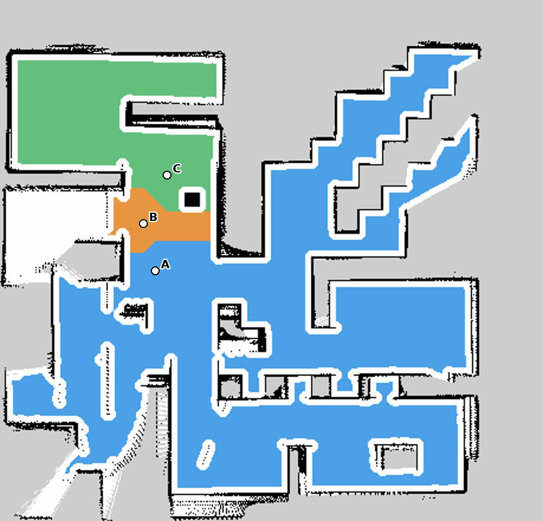

# Bài thực hành 7 — Điều hướng TurtleBot 4 bằng giọng nói

Ubuntu 22.04, ROS 2 Humble, Gazebo Fortress, Nav2 và Whisper base tiếng Việt.

Source, PGM/YAML nguồn, ảnh phân vùng, vùng A/B/C, 5 WAV tiếng nói tổng hợp, video demo và báo cáo 2 trang được cung cấp trong repository này.



## Chạy nhanh

Clone repository vào một ROS workspace riêng, cài TurtleBot 4 Simulator và các dependency theo README package, rồi chạy trong thư mục repository.

```bash
source /opt/ros/humble/setup.bash
colcon build --symlink-install --packages-select turtlebot4_slam_nav2 turtlebot4_voice_nav
source install/setup.bash
bash src/turtlebot4_voice_nav/tools/setup_speech.sh
bash src/turtlebot4_voice_nav/tools/run.sh simulation
```

Hai terminal tiếp theo mở dashboard và chạy demo tự động.

```bash
bash src/turtlebot4_voice_nav/tools/run.sh dashboard --demo-mode
bash src/turtlebot4_voice_nav/tools/run.sh demo
```

Xem [hướng dẫn chi tiết](src/turtlebot4_voice_nav/README.md), [báo cáo Word](reports/Bao_cao_Bai_07.docx), [báo cáo PDF](reports/Bao_cao_Bai_07.pdf), [video demo](reports/demo_voice_navigation.mp4) và [kết quả chạy](src/turtlebot4_voice_nav/results/integration_results.json).

Demo sử dụng WAV tổng hợp Piper theo lựa chọn của người thực hiện. Ba lệnh giọng nói A, phòng thí nghiệm và A → B được kiểm chứng. Clip C nhận sai và bị từ chối, đích C được kiểm tra riêng bằng text có ghi nguồn. Độ chính xác giọng người thật chưa được đo. Báo cáo ghi số liệu ASR và điều hướng từ lượt chạy thực tế.

Code Apache-2.0. WAV demo có nguồn Piper/VAIS-1000, xem THIRD_PARTY.md. Model Whisper tải riêng bằng script.
